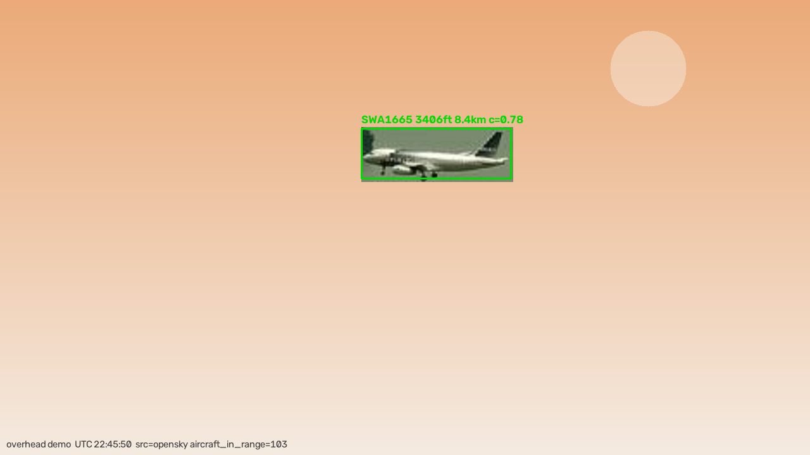

# overhead

  

<em>Synthetic-replay validation frame. The pipeline sees only pixels — the callsign, altitude, and range in green are recovered independently from the live ADS-B feed.</em>

A camera, a detector, and the public ADS-B network — answering *"what plane
is that?"* in real time.

- **Detect** — YOLOv8 finds aircraft in the frame at ~10 ms/frame (RTX 2080)
- **Track** — IoU tracker with constant-velocity coasting over detection dropouts
- **Identify** — each track's geometry is correlated against live public ADS-B
  (OpenSky / airplanes.live / adsb.lol); the winner gets its callsign,
  altitude, and range overlaid
- **Emit** — every confirmed match goes out as a ZeroMQ event and a flight-log line

Built and validated under the DFW arrival corridor — one of the densest
patches of civilian sky anywhere: 100+ aircraft transmitting within 25 nm
at any moment.

## Demo

**[▶ docs/demo.mp4](docs/demo.mp4)** — 103 s, synthetic-replay mode: a sprite
flies a **real live aircraft's** projected path while the pipeline
independently detects, tracks, and identifies it. Ground truth comes from the
live feed, but the pipeline never sees it — if the overlay recovers the right
callsign, the whole loop is proven.

| Run | Truth | Detection | Correct callsign | First lock | Angular err |
|---|---|---|---|---|---|
| 2026-11-11 | JSX210 | 99.1% | 3882/3882 (100%) | 1.8 s | 0.95° |
| 2026-11-11 | SWA1665 | 94.2% | 2919/2919 (100%) | 1.8 s | 1.06° |

Full artifacts: [docs/summary.json](docs/summary.json),
[docs/flight_log.jsonl](docs/flight_log.jsonl),
[docs/frame_0900.png](docs/frame_0900.png).

Earlier runs (before correlation tuning) showed the real problem in this
sky: label flip-flops between aircraft 2–3° apart in bearing. Fixes that got
to 100%: tighter angular gate (4°), elevation weighted equally with bearing,
6-vote confirmation, sticky incumbency (a confirmed match must be beaten by
2° to change hands), and fresh-measurement gating (coasted ghost tracks may
not claim callsigns).

**Honest open problems:** aircraft that turn hard between ADS-B polls
(straight-line dead reckoning diverges); multiple aircraft within ~1–2° of
bearing; apparent-size-vs-range gating is unimplemented.

## How it works

    frames (camera / synthetic replay)
        -> YOLOv8 airplane detections (PyTorch, ~10 ms/frame on RTX 2080)
        -> IoU tracker (constant-velocity coasting over dropouts)
        -> correlator: track pixel -> (bearing, elevation) via camera FOV
                       vs live ADS-B positions -> (bearing, elevation)
                       greedy nearest-match, angular gate, vote + sticky
        -> overlay (callsign / altitude / range) + ZMQ events + flight log

Geodesy: haversine + great-circle bearing + elevation from camera
(lat/lon/alt). Dead reckoning advances aircraft between polls along ground
track at ground speed.

## Volume prediction (v0 — funnel physics)

`python -m overhead.volume --nowcast` predicts overflights for the next hour
from live kinematics: each aircraft's position + velocity vector is
dead-reckoned straight-line; time and distance of closest approach to the
camera yields an ETA table. Weather context comes from Open-Meteo (keyless)
and the DFW METAR (wind → north/south flow annotation, which shifts which
corridors cross a given neighborhood).

Live sample (2026-11-11 22:50 UTC, 105 aircraft in range): 5 predicted
overflights within 15 min, 7 within 30, 9 within 60 — callsigns, ETAs, miss
distances.

Closed-loop verification (7.5 min later): 0/2 due predictions overhead —
one left the feed (coverage gap), one turned to land (terminal-area
maneuvering defeats straight-line kinematics). Known v0 limits, documented
with the fix ladder: ETA-windowed verification from the continuous logger →
turn detection (track-rate gate) near the airport → a learned model once
weeks of `--log` history exist (the log schema already captures the
features).

## Run

    # deps: torch+cu, ultralytics, opencv, pyzmq (see requirements.txt)
    cp config.example.json config.json   # then set YOUR camera lat/lon/alt
    python -m overhead.pipeline --seconds 60

The run picks the best live target (close, approach speed, high in the
sky), auto-locks camera azimuth, and validates against it. Output lands in
`out/`: an overlay video, sample frames, a JSONL flight log, and
`summary.json` (validated true/false + stats). `config.json` is gitignored —
your location stays yours.

To co-record the raw ADS-B feed alongside a camera capture (enables
real-footage offline replay):

    python -m overhead.adsb --record adsb_log.jsonl --minutes 3

## Repo layout

    overhead/geo.py         haversine, bearing, elevation, pixel<->angle
    overhead/adsb.py        live ADS-B poller (3 public sources, fallback) + --record
    overhead/tracker.py     IoU tracker w/ velocity coasting
    overhead/correlator.py  angular matching, votes, stickiness
    overhead/sim.py         synthetic-replay validation source
    overhead/volume.py      overflight nowcast (funnel physics + weather)
    overhead/pipeline.py    end-to-end demo (this is what you run)
    tests/                  geodesy + tracker unit tests
    docs/                   demo video, overlay frames, logs from validation runs

## Roadmap

- [x] v0.1 — end-to-end validation vs live DFW traffic (synthetic replay)
- [x] Volume nowcast + weather context
- [ ] Real-footage demo — video-file source + ADS-B co-recording + offline replay
- [ ] RTSP camera source (same VideoCapture path as the video-file source)
- [ ] One-command calibration — time/azimuth offset scan scored by the correlator
- [ ] Always-on service + daily flight-log summaries
- [ ] ETA-windowed closed-loop verification of volume predictions
- [ ] Learned volume model (hour, day-of-week, weather, live funnel state)

## Data & legality

ADS-B is public by design — that's the point of the system. No account,
key, or special access required for the sources used. Detector weights
fine-tuned on coco128 (public COCO subset). Nothing here touches restricted
data.

## Credits & status

ADS-B data: The OpenSky Network, airplanes.live, and adsb.lol — and the
crowd of receivers feeding them. This project is independent and
unaffiliated with any of them.

Personal project by Devin Slick — v0.1 validated 2026-11-11, real-footage
demo next. <https://github.com/devinslick/overhead>
